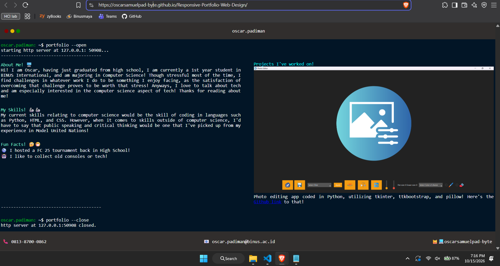
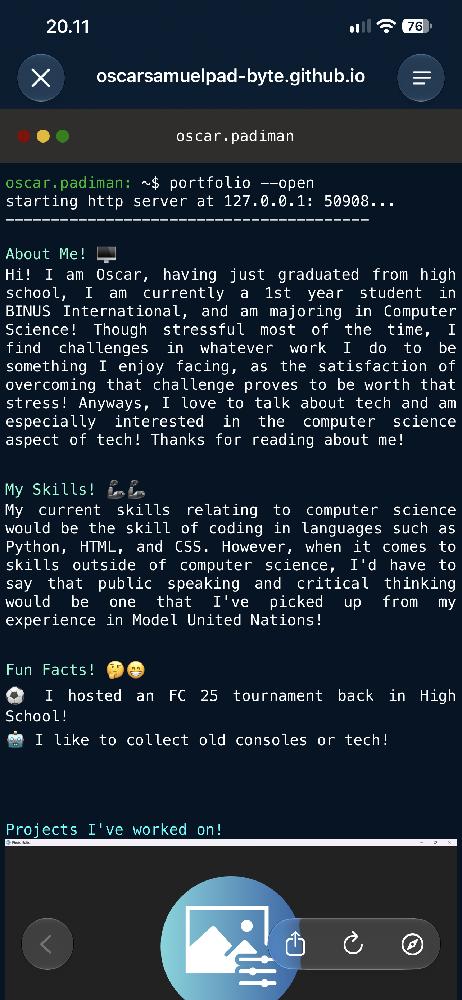
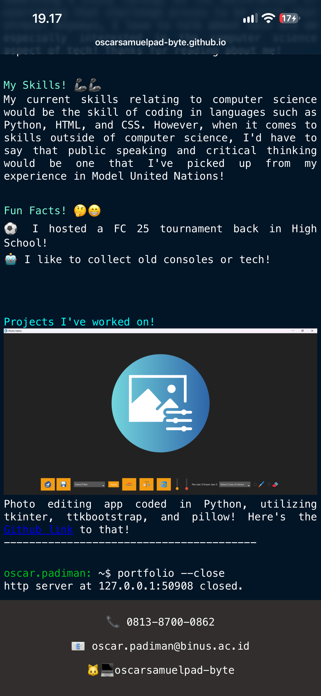
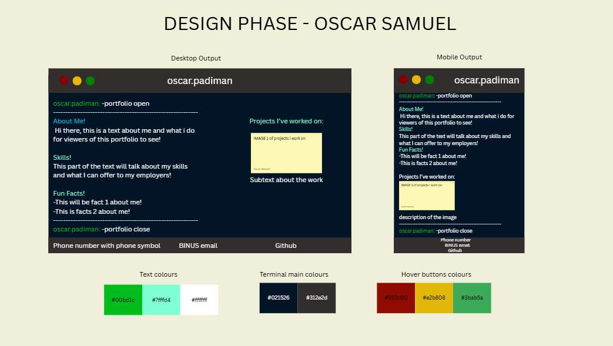

# 📄 Personal Portfolio Website

## 📠 Project Overview
A single-page responsive portfolio website created for a lab assignment in HCI. My portfolio is heavily inspired by the look of the linux or mac terminals and their "fastfetch" commands. This website is made utilizing previous learned materials such as headers, footers, padding, sections, with the new topic of responsiveness in a website.

[🔗] Here are the links to the:
- Website design: [I am the link, click me!](https://canva.link/ptjpv1m1pxruyou)
- Website portfolio: [I am the link too! Click me!](https://oscarsamuelpad-byte.github.io/Responsive-Portfolio-Web-Design/)

## 🎯 Purpose
The goal of this project is to:
- TO create a portfolio that represents my skills and I.
- TO have a way to display the work I've done through the portfolio.
- TO practice responsive web designs and previous taught materials from HCI Lab through HTML and CSS and have a productive output from it.

## 👀 Target audience:
- [✅] Potential employers
- [✅] Peers

## 🖥️ Technologies used:
- HTML5
- CSS3 (Flexbox, Box Models, Media Queries)

## 📐 Layout & Sections
The website I have made includes sections such as:

- **Header** - "Mac" buttons that showcase a hover functionality, with my name in the center.
- **About Me** - A description to introduce myself to others.
- **My Skills** - A description about my skills and what I can offer to my employers/peers.
- **Fun Facts** - 2 fun facts to get to know me more.
- **Projects I've worked on!** - An image showcase of my works, with a subtext describing what it is.
- **Footer** - 3 sections showcasing my number, BINUS email, and Github username for my peers or potential employers to contact me.

## 📱 Responsiveness

The site is optimized for:

- Desktop
- Tablet
- Mobile

> Responsive design is achieved using media queries and flexible layouts.

## 🧪 How to Run Locally

1. Open your code editor (e.g., Visual Studio Code, etc.).
2. In your code editor, open the terminal.
3. Clone the repository:
   ```bash
   git clone https://github.com/oscarsamuelpad-byte/Responsive-Portfolio-Web-Design
   ```
4. Open index.html in your browser, or run the website locally using the Live Server Extension.

## 📂 Folder Structure

```bash
Responsive-Portfolio-Web-Design/
│
├── index.html
├── style.css
├── images/
│   ├── projectsample.png
│   ├── Portfolio-mobile-1.png
│   ├── Portfolio-mobile-2.png
│   ├── Portfolio-desktop.png
└── README.md
```

## 📝 Notes

- I used Google's Gemini AI to help me structure the HTML layout and fix multiple CSS bugs, while also using the AI to explain concepts that are either new or concepts I forgot.
- I designed the color scheme and layout myself Canva.
- I wrote the project descriptions and contact section manually.
- I understand what's in my HTML and CSS code.

## 📷 Screenshots






